# The bed and the effective pressure from the radar alone

`baker/` (the model and its options: [`baker/README.md`](../baker/README.md))
fits one ice thickness under the north-side glaciers, and so one bed, and an
effective pressure in two parts: a stationary field shared by every campaign,
and each campaign's departure from it. Every input on this page is the
radar's: the line-of-sight strain rates of the joint inversion
([`joint.md`](joint.md)) and each campaign's own surface, from the phase
between its two receive antennas. ITS_LIVE is left out.

## The radar's own surfaces

Each campaign's surface is measured against the 2015 USGS lidar
(`GPRI_DEM_LIDAR`) as `dh`, the radar's surface minus the lidar
(`baker/radar_dem.py`). The phase between the two receive antennas is stacked
over up to 96 epochs spread over the record. It is fitted on ice-free ground
above 1700 m with slopes below 45° (3,867–4,930 looks per campaign, almost
all between 1700 and 2300 m), with the campaign's own effective baseline, a
planar phase ramp, a `1/R` term, a constant and a sub-look shift of the lidar.
`dh` is binned onto the model's 50 m grid and averaged over 200 m. Its
standard deviation comes from the scatter of the ice-free looks in five
slant-range bands; the 85–298 coherent ice looks per campaign nearer or
farther than any ice-free ground take the nearest band's.

| campaign | baseline (m) | phase sd (rad) | ice cells | `dh` on the ice, median (5th to 95th %) (m) | formal sd on the ice, median (m) | ice-free cells at or above 1700 m, robust sd (m) |
|---|---:|---:|---:|---:|---:|---:|
| `20170713_full` | +0.358 | 0.11 | 4,608 | +6.8 (−19.5 to +18.8) | 0.79 | 4.65 |
| `20170803_full` | +0.358 | 0.11 | 4,629 | +8.0 (−14.4 to +21.9) | 0.82 | 4.59 |
| `20170827` | −0.809 | 0.24 | 4,605 | +7.8 (−16.0 to +19.1) | 0.78 | 4.25 |
| `20170913` | +0.239 | 0.11 | 4,656 | +5.9 (−12.8 to +21.8) | 1.28 | 4.92 |
| `20180709` | −0.811 | 0.27 | 4,508 | +9.0 (−13.3 to +21.4) | 0.82 | 4.85 |
| `20180808` | +0.805 | 0.23 | 4,607 | +5.8 (−19.3 to +18.3) | 0.79 | 4.22 |
| `20190719` | −0.801 | 0.26 | 4,643 | +5.2 (−18.0 to +15.7) | 0.82 | 4.81 |

The baseline is the effective one, `k × 0.25 m`. Ice cells are the 50 m grid
cells on the RGI ice with a value.

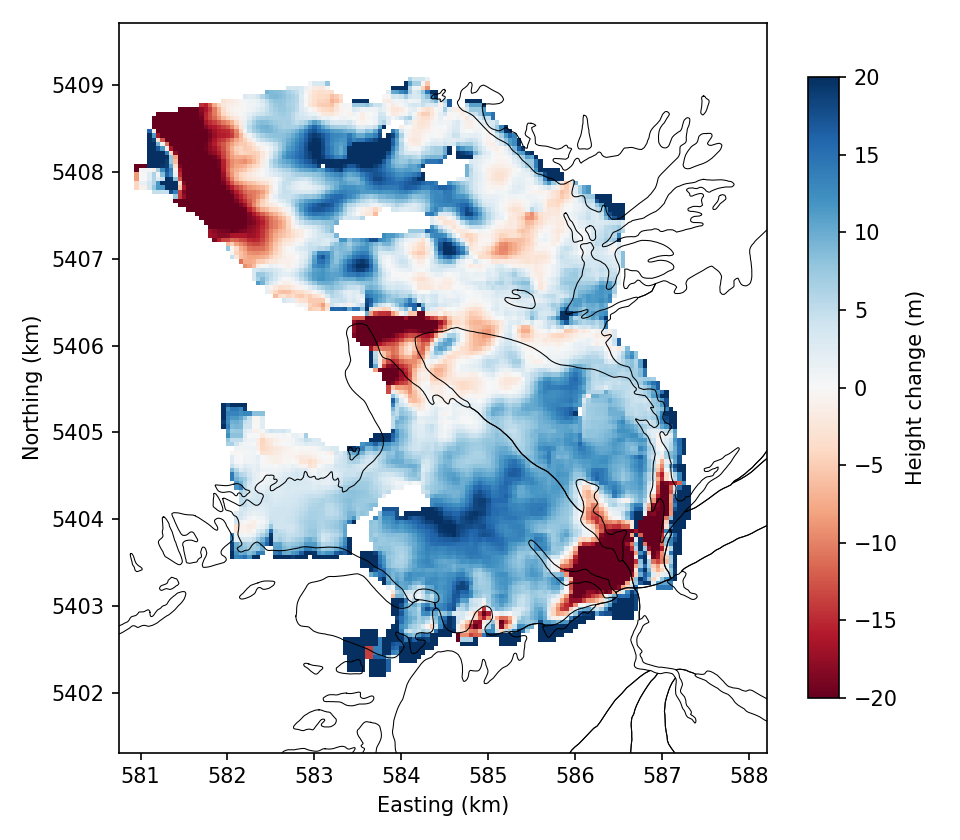
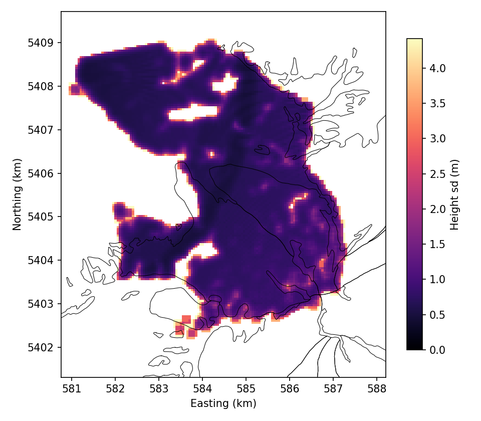

*`dh` for `20170803_full` and its formal standard deviation, on the 50 m
grid, RGI outlines in black. `43_radar_dh_<campaign>.png` has every
campaign.*

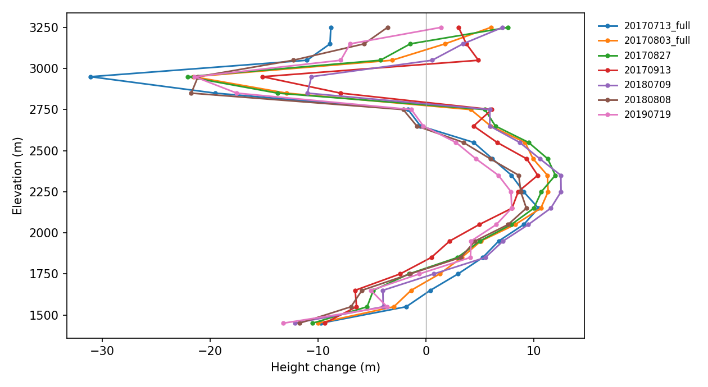

*Median `dh` on the ice in 100 m bands of lidar elevation, every campaign,
per-campaign calibration.*

### Calibrated together

`baker/radar_joint.py` refits all seven campaigns at once: the same terms per
campaign, plus one height term shared by all of them,
`E = e1 z² + e2 z R`, with `z = (h − 2000 m) / 1 km` and
`R = (R − 7.5 km) / 1 km`. A term linear in `z` alone is not separable from
the baselines, nor `R²` from the ramp and the `1/R` term. Fitted:
`e1 = −81.7 m`, `e2 = +38.6 m`. Extrapolated onto the ice, `E` is −0.8 m at
2100 m, −40.0 m at 2700 m and −81.7 m at 3000 m at a slant range of 7.5 km,
and −139.6 m at 3000 m at 6.0 km. The joint baselines are 4.3–4.7 % larger
in magnitude than the per-campaign ones.

Both calibrations are scored on ice-free ground left out of the fit (robust
sd of `dh`, m): by 1 km blocks in five folds, and by fitting below 2150 m
and scoring above it.

| campaign | blocks, per campaign | blocks, joint | above 2150 m, per campaign | above 2150 m, joint |
|---|---:|---:|---:|---:|
| `20170713_full` | 5.75 | 5.52 | 4.39 | 4.99 |
| `20170803_full` | 5.70 | 5.40 | 5.69 | 5.31 |
| `20170827` | 4.87 | 5.00 | 5.14 | 5.70 |
| `20170913` | 7.45 | 6.97 | 9.22 | 8.34 |
| `20180709` | 5.55 | 5.44 | 5.62 | 5.38 |
| `20180808` | 5.10 | 5.17 | 5.63 | 5.61 |
| `20190719` | 6.18 | 6.30 | 6.43 | 7.68 |

The joint calibration has the lower held-out sd in four of seven campaigns on
each test. The spread between campaigns in the same ice cell (sd across
campaigns, median over the 4,414 cells with a value in all seven):

| lidar elevation (m) | cells | all seven, per campaign | all seven, joint | four 2017, per campaign | four 2017, joint |
|---|---:|---:|---:|---:|---:|
| 1500–2000 | 1,067 | 2.0 | 1.9 | 2.1 | 1.9 |
| 2000–2300 | 1,544 | 1.9 | 1.9 | 1.7 | 1.5 |
| 2300–2600 | 1,044 | 2.7 | 2.7 | 2.1 | 1.6 |
| 2600–3300 | 687 | 5.4 | 4.6 | 5.3 | 4.0 |

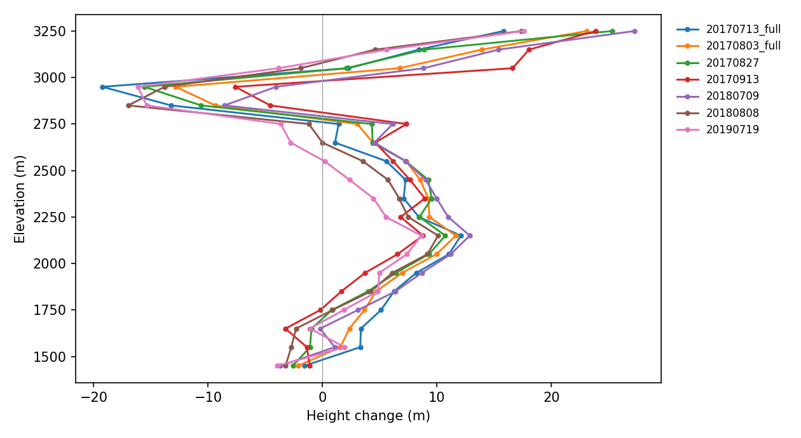

*The same profiles, joint calibration.*

The inversion below uses the per-campaign surfaces (`radar_single/`).

## The inversion

The data are the joint inversion's line-of-sight strain rates between
neighbouring 200 m ice cells: at six times of day for the five campaigns with
24 h terms, and the mean rate alone for the two shorter than a day. All seven
campaigns are fitted together, each over its own surface from `radar_single/`.

| campaign | times of day | cells | pairs | observations |
|---|---:|---:|---:|---:|
| `20170713_full` | 6 | 320 | 960 | 5,760 |
| `20170803_full` | 6 | 318 | 930 | 5,580 |
| `20170827` | 6 | 318 | 926 | 5,556 |
| `20170913` | 1 | 337 | 1,073 | 1,073 |
| `20180709` | 1 | 309 | 867 | 867 |
| `20180808` | 6 | 315 | 926 | 5,556 |
| `20190719` | 6 | 327 | 1,003 | 6,018 |

The unknowns are:

- one thickness under the 2015 surface, `H_2015 = H_prior exp(theta_H)`
  (prior: Farinotti et al. 2019), and so one bed `b = s_2015 − H_2015` under
  every campaign;
- one stationary `q_bar`;
- for each campaign a departure `q0` and, with 24 h terms, `qc` and `qs`, so
  that `N(t) = exp(q_bar + q0 + qc cos ωt + qs sin ωt)` (MPa, `t` the UTC hour).

Campaign `k` sees the surface `s_k = s_2015 + dh_k` (`dh_k` where the radar
has a value, zero elsewhere) and the thickness `max(H_2015 + dh_k, 0)`.

The regularization (`baker/inverse.py`):

- smoothing lengths: 500 m on `theta_H`, 1000 m on every `log N` field;
- prior spreads: 0.5 on `theta_H`, 0.5 on each `q0`, 1.0 on the 24 h terms.

The mesh has 5,600 triangles, and one evaluation solves 32 momentum balances.
L-BFGS-B stopped at its limit of 100 iterations, after 13 h 20 min. The
objective fell from 38,107.8 to 15,445.3, by 4.1 over the last ten
iterations.

The misfit per observation is ½ mean((r/σ)²) over a campaign's observations,
so it is 0.5 when the residuals are the size of their standard deviations. The
per-campaign values below are taken at the campaign's own observed cells (each
at its nearest 50 m grid cell; 13–21 cells per campaign fall off the grid's
RGI ice and are left out).

| campaign | misfit, iteration 0 | misfit, iteration 100 | `q0`, median (5th to 95th %) | mean `N`, median (5th to 95th %) (MPa) | 24 h amplitude of `log N`, median / 95th % |
|---|---:|---:|---:|---:|---:|
| `20170713_full` | 0.535 | 0.256 | +0.046 (+0.008 to +0.150) | 1.00 (0.86 to 1.17) | 0.017 / 0.087 |
| `20170803_full` | 0.758 | 0.225 | −0.001 (−0.022 to +0.012) | 0.94 (0.76 to 1.15) | 0.062 / 0.096 |
| `20170827` | 0.58 | 0.274 | +0.026 (+0.002 to +0.057) | 0.97 (0.80 to 1.16) | 0.077 / 0.148 |
| `20170913` | 16.6 | 2.6 | −0.079 (−0.223 to +0.006) | 0.88 (0.63 to 1.15) | — |
| `20180709` | 0.434 | 0.228 | +0.000 (−0.003 to +0.009) | 0.94 (0.78 to 1.15) | — |
| `20180808` | 0.639 | 0.293 | +0.005 (−0.010 to +0.029) | 0.94 (0.79 to 1.15) | 0.062 / 0.175 |
| `20190719` | 0.971 | 0.397 | −0.006 (−0.055 to +0.015) | 0.93 (0.75 to 1.15) | 0.119 / 0.226 |

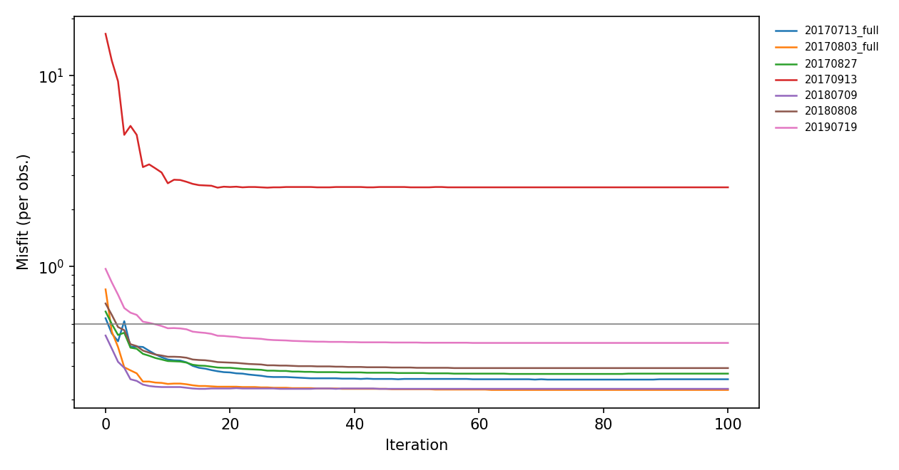

*Misfit per observation against iteration, each campaign; the grey line marks
0.5.*

Thickness, median (5th to 95th %):

| | inverted (m) | prior (m) | median ratio |
|---|---:|---:|---:|
| the grid's 9,971 RGI ice cells | 42 (11 to 83) | 48 (17 to 89) | 0.90 |
| the 560 grid cells nearest the campaigns' observed cells | 41 (11 to 76) | 49 (18 to 86) | 0.82 |

The bed on the ice is 2,176 m (1,703 to 2,929 m).

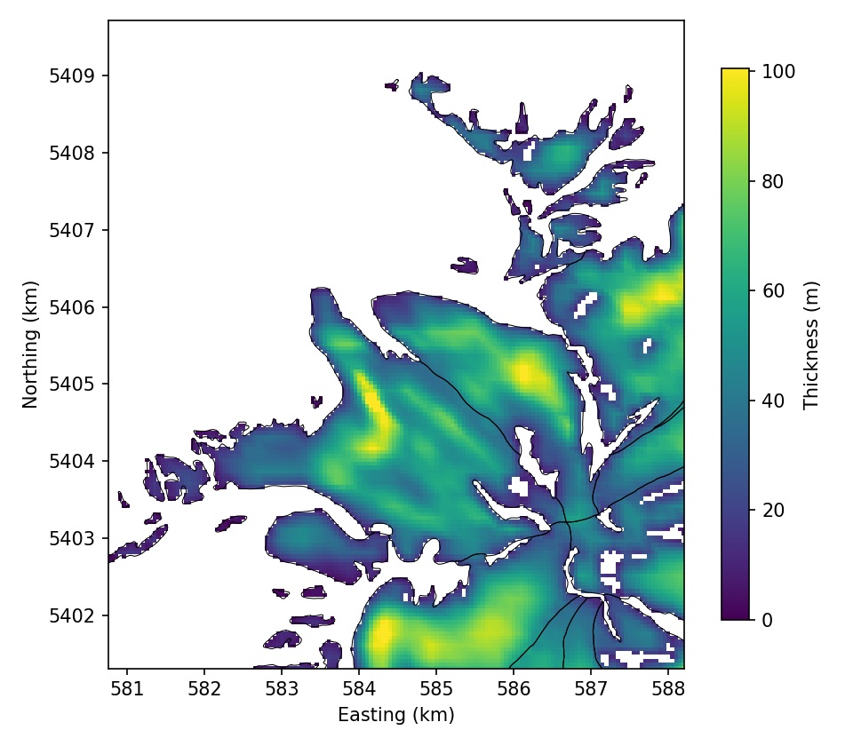
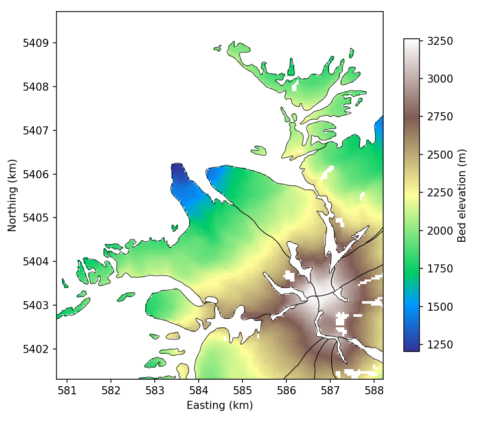

*The thickness under the 2015 surface and the bed elevation, RGI outlines in
black.*

The stationary effective pressure `N_bar = exp(q_bar)` is 0.98 MPa
(0.82 to 1.29 MPa) on the ice and 0.94 MPa (0.78 to 1.15 MPa) at those 560
cells.

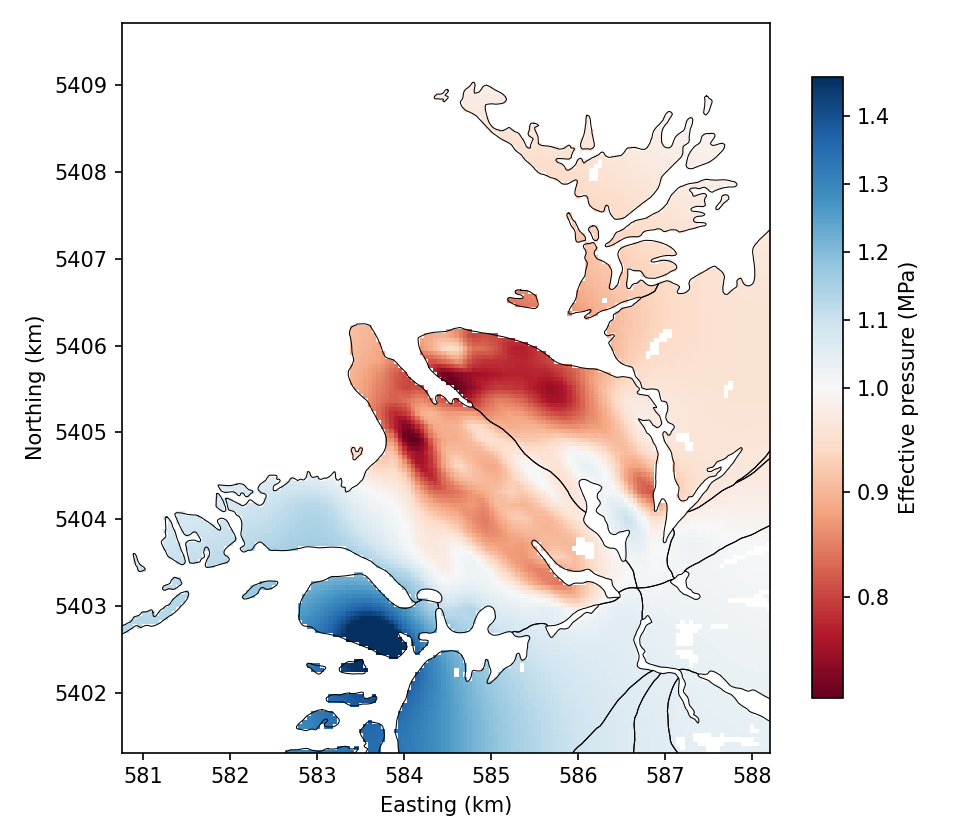

*`N_bar` (MPa), colour scale centred on 1 MPa.*

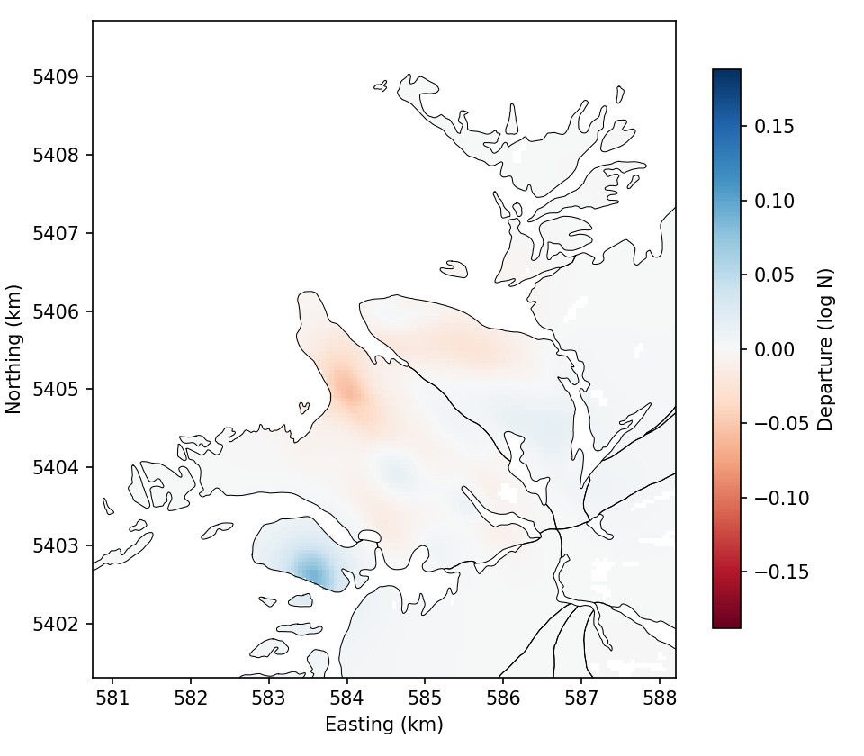

*`q0` for `20170803_full`, the campaign's departure from `q_bar` in `log N`,
on the colour scale all seven share. `46_flow_dlogn_<campaign>.png` has every
campaign.*

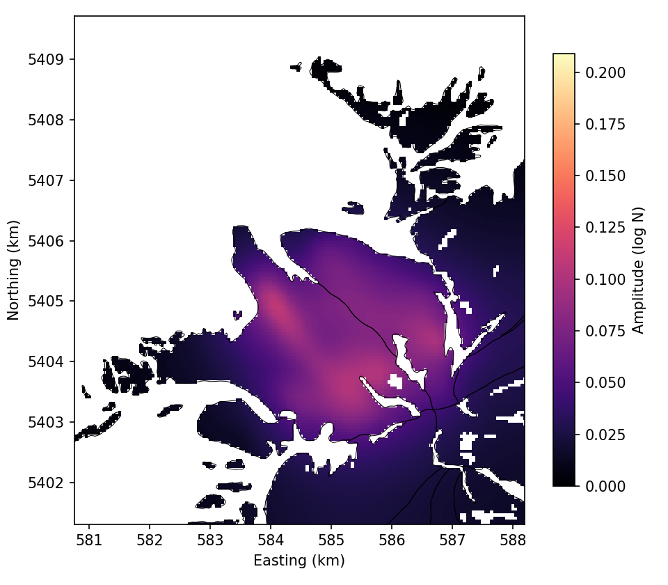
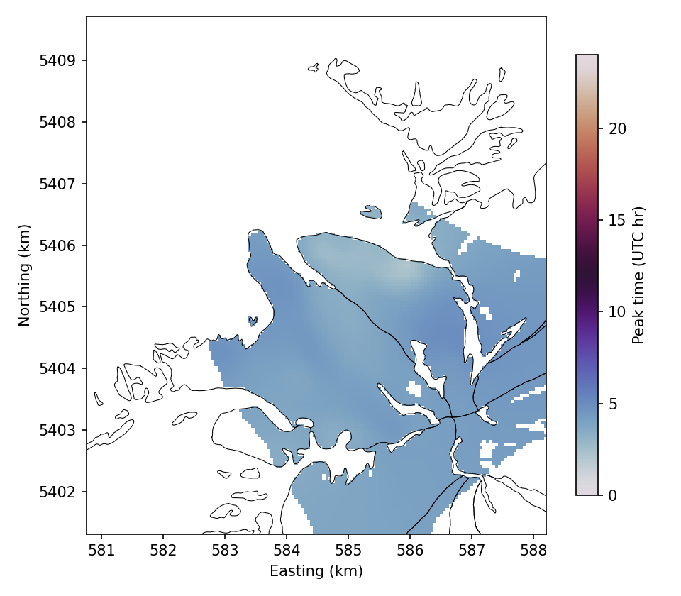

*The 24 h amplitude of `log N` for `20170803_full`, and the UTC hour of its
maximum. The hour is drawn where the amplitude exceeds a tenth of the 99th
percentile over all five campaigns. `47_flow_logn_amp_<campaign>.png` and
`47_flow_logn_peak_<campaign>.png` have the five campaigns with 24 h terms.*

## Reproduce

The model side needs Firedrake, icepack and icepack2 (see
[`baker/README.md`](../baker/README.md)); everything else runs where the
examples do.

```bash
# the grid and every campaign's strain rates (after examples/baker_joint.py)
python -m baker.prepare
# each campaign's surface from the two antennas; both calibrations and
# their held-out scores and shared term (printed), into radar_single/ and radar_joint/
python -m baker.radar_dem --scene all
python -m baker.radar_joint
# the inversion (Firedrake): the radar campaigns only, --years with no years,
# without mass continuity (now the default)
python -m baker.run --years --no-continuity --out radar_friction
# the model's observations at the saved fields (Firedrake), then the plots
python -m baker.figures --run radar_friction --predict
python -m baker.figures --run radar_friction
python -m baker.figures --radar --radar-source radar_single
python -m baker.figures --radar --radar-source radar_joint
# the copies in docs/figures, and every other number on this page
python -m baker.figures --run radar_friction --docs docs/figures
python -m baker.summary --run radar_friction
```
