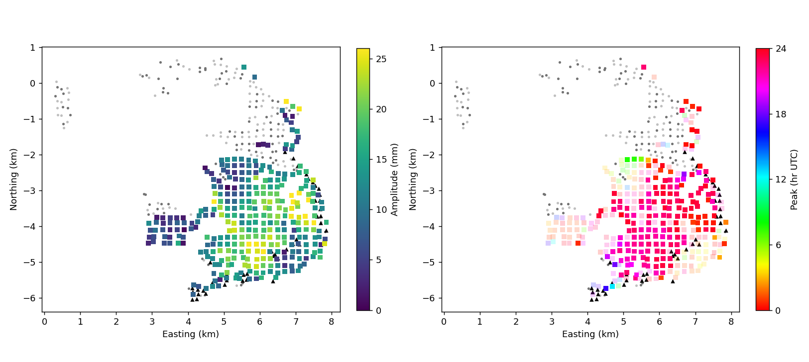
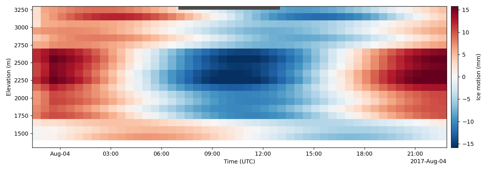

# One inversion for the path and the ice

The ladder ([`atmosphere.md`](atmosphere.md)) and the temporal path delay
([`pathdelay.md`](pathdelay.md)) are separate steps, each fitted and then
subtracted from the series the next one sees. `gpri_tools.jointinv` replaces
them with one linear model of the **uncorrected, integrated series of both
antennas**, solved for a whole campaign at once, and
`examples/baker_joint.py` runs it on every campaign.

## Using it

Two calls take any set of campaigns from one tripod position from arrays to
results. Nothing below is specific to Baker:

```python
from gpri_tools import jointinv as J
from gpri_tools.plot import joint_elevation_time, joint_harmonic_map

# per campaign: days since the first epoch, both antennas' integrated LOS (mm,
# epochs x azimuth x range), map x/y (m), slant range, height, and the masks
camps = {name: J.build_campaign(t, upper, lower, x, y, r, z,
                                fit=fit, ice=ice, held=held, cand=cand,
                                origin_hour=utc_hour_of_first_epoch)
         for name, (t, upper, lower, x, y, r, z, fit, ice, held, cand,
                    utc_hour_of_first_epoch) in data.items()}
inv = J.invert(camps)                 # map=pool.map runs campaigns in parallel
inv.save("joint/")                    # J.Inversion.load("joint/") reads it back

amp, sigma, peak = inv.results[name].harmonic(camps[name].origin_hour)
sigma *= np.sqrt(np.mean(inv.kappa[name][1:3]))     # the held-out calibration
joint_harmonic_map(ax, inv.results[name], camps[name], "peak")
```

`Campaign.save` / `Campaign.load` cache the cell series, so a figure can be
redrawn from saved results without the radar data.

## The model

The scene is cut into 200 m ground cells of four kinds: the fit half of the
stable ground, RGI ice (mean coherence ≥ 0.5), candidate reference ground,
and the held-out half of the stable ground. The stable ground is split into
its two halves by whole cells, drawn at random, so no held-out cell shares a
cell with fit rock. Each antenna's series is reduced to one median per cell
and epoch; a cell with no valid pixel at any epoch of either antenna is
dropped. Heights are the 2015 USGS lidar DEM
(1 m, flown 26 August–27 September 2015; `GPRI_DEM_LIDAR`), with the
Copernicus 30 m DEM where the lidar has no coverage. At every epoch each value
of the fit rock, the ice and the candidates is

    y_k = F beta_k + s_k + E (G_k theta + a_k) + n_k

| term | what it is | prior |
|---|---|---|
| `F beta_k` | a trend in slant range, its square and height | flat, per epoch |
| `s_k` | the path field over rock, ice and candidates alike, exponential covariance, amplitude allowed to grow with range | per epoch, scaled by the rock's own variance |
| `theta` | per ice or candidate cell, constant in time: offset, rate, 24 h cosine and sine (rate only on a record under a day) | flat on ice |
| `a_k` | ice motion that is neither: a Gaussian process over the ice cells, 600 m | per epoch |
| `n_k` | noise per antenna sized from upper − lower, each cell's own level from its own difference, plus a part shared by both antennas | — |

`theta` is solved by generalized least squares over every epoch at once with
everything else marginalised. The shape of the path prior (length scale,
growth with range, shared noise) is chosen per campaign by marginal likelihood
on the fit-half rock. The held-out rock never enters the solve. The path is
predicted there afterwards, and the difference scores the model.

## Candidate reference ground

Above 2300 m the fit-half reference has 2–5 cells per campaign. The
candidates are coherent ground off the outlines that the reference rules
exclude: inside the 100 m outline buffer, or at mean coherence 0.6–0.85, at
or above 2300 m (85–89 cells per campaign; the cache keeps candidates of
every height and `--cand-min-z` picks them). Each gets its own offset, rate
and 24 h terms, and its own remainder, so a moving candidate describes itself
instead of feeding the path.

Whether a candidate is stationary is decided once per ground location, from
all seven campaigns together. The tripod position is the same to about 4 m in
every campaign, so the cell lattice is shared.

- **The stationary spread** for a candidate's motion terms is its own formal
  variance from the solve, scaled by a factor measured on held-out rock
  (`calibrated_spike`). For that one calibration solve, every other held-out
  cell is entered as a free candidate; the scored solve never contains them.
- **Why per candidate.** A candidate beyond the rock carries the path field's
  extrapolation error in its rate and harmonic. Held-out rock near the fit
  rock never sees that error.
- **The decision.** A two-component mixture (still / moving) sums its
  evidence over campaigns (`shared_stationarity`). The posterior probability
  `p` then sets a prior precision `p / spread` on the candidate's motion terms
  and a remainder `(1 − p) a2`.

The calibration factor itself is a measurement. The formal variance of a
held-out rock cell's motion terms under-states the truth by 15× to 420×,
because the model treats path and remainder as independent between epochs:

| campaign | path length | range growth | shared noise | calibration (rate, cos, sin) |
|---|---:|---:|---:|---|
| `20170713_full` | 1000 m | 0.4 /km | 9× | 54, 16, 15 |
| `20170803_full` | 1000 m | 0 | 2× | 156, 62, 66 |
| `20170827` | 1000 m | 0.4 /km | 9× | 422, 52, 60 |
| `20170913` | 4000 m | 0 | 9× | 79 |
| `20180709` | 2000 m | 0 | 9× | 44 |
| `20180808` | 2000 m | 0.4 /km | 9× | 154, 43, 25 |
| `20190719` | 500 m | 0 | 2× | 157, 20, 27 |

Of 90 candidate locations, 43 come out stationary (p > 0.5): 16 of 31 at
2300–2500 m, 23 of 44 at 2500–2900 m, 1 of 12 above 2900 m. They lie at
2250–2940 m and 6.9–9.0 km slant range.

### How well it tells still ground from moving

Ground whose state is known goes through the same mixture, which is not
refitted for it: the held-out cells the calibration did not use (176
locations), and the ice (340 locations).

| | called still | below 2300 m | 2300–2500 m | above 2500 m |
|---|---:|---:|---:|---:|
| held-out rock | 74 % | 73 % of 165 | 3 of 3 | 7 of 8 |
| ice | 20 % | 26 % of 203 | 17 % of 60 | 9 % of 77 |

The evidence is the rate and the 24 h terms together. The probability, not
the call, enters the final solve.

## Scores on held-out rock

The stable ground is split into its two halves by whole 200 m cells drawn at
random, so no held-out cell shares a cell with fit rock. Each antenna's series
is reduced to one median per cell and epoch, and a cell with no valid pixel at
any epoch is dropped. Scored: the anomaly RMS of the pixel-weighted mean
series over the held-out cells the calibration did not use (about each
series' own secular line), and its 24 h amplitude, in mm. Each entry compares
the ladder (run on each antenna, the two averaged), the joint inversion
without candidates, and with them, on the same cells; all three average both
antennas.

| campaign | above 2500 m, RMS | above 2500 m, 24 h | below 2300 m, RMS | below 2300 m, 24 h |
|---|---|---|---|---|
| `20170713_full` | 6.50 / 6.40 / 4.80 | 2.10 / 4.65 / 3.84 | 0.98 / 0.86 / 0.86 | 1.31 / 0.75 / 0.74 |
| `20170803_full` | 15.28 / 4.25 / 2.98 | 8.57 / 3.86 / 2.98 | 1.51 / 0.91 / 0.91 | 1.41 / 0.68 / 0.67 |
| `20170827` | 9.47 / 12.98 / 10.52 | 4.25 / 13.27 / 11.06 | 2.28 / 1.63 / 1.69 | 1.31 / 0.46 / 0.52 |
| `20170913` | 4.71 / 2.92 / 1.57 | — | 0.21 / 0.16 / 0.22 | — |
| `20180709` | 5.77 / 1.75 / 1.24 | — | 0.36 / 0.37 / 0.37 | — |
| `20180808` | 20.12 / 7.42 / 3.97 | 20.91 / 8.06 / 1.95 | 1.27 / 1.29 / 1.28 | 0.45 / 0.84 / 0.83 |
| `20190719` | 11.37 / 5.05 / 4.71 | 8.81 / 3.24 / 4.33 | 1.23 / 1.10 / 1.10 | 1.13 / 0.31 / 0.30 |

Above 2500 m each entry rests on 1–3 held-out cells, below 2300 m on 34–48.
With the earlier pixel-by-pixel split, where held-out pixels shared cells with
fit rock, the low rock scored 0.04–0.35 mm; the split by cell scores
0.16–1.69 mm.

## The ice

24 h amplitude of the pixel-weighted mean phasor over the ice cells, its hour
of peak, the median single-cell amplitude, the median per-cell sigma (formal,
scaled by the calibration above), and the mean rate:

| campaign | below 2300 m | above 2500 m |
|---|---|---|
| `20170713_full` | 6.49 mm at 02.7 h; cell 7.14 ± 4.56 mm; +10.0 m/yr | 4.86 mm at 13.5 h; cell 6.92 ± 8.14 mm; +12.6 m/yr |
| `20170803_full` | 10.13 mm at 22.9 h; cell 11.95 ± 6.64 mm; +39.7 m/yr | 11.68 mm at 24.0 h; cell 12.90 ± 7.14 mm; +29.2 m/yr |
| `20170827` | 7.99 mm at 17.3 h; cell 8.32 ± 4.67 mm; +16.7 m/yr | 4.83 mm at 23.4 h; cell 9.05 ± 5.93 mm; +3.3 m/yr |
| `20180808` | 5.69 mm at 23.8 h; cell 7.07 ± 4.62 mm; +31.7 m/yr | 6.33 mm at 21.7 h; cell 8.12 ± 7.77 mm; +21.2 m/yr |
| `20190719` | 7.68 mm at 14.7 h; cell 7.04 ± 3.81 mm; +35.3 m/yr | 10.27 mm at 20.0 h; cell 11.41 ± 3.79 mm; +15.9 m/yr |

Hours are UTC. With the calibrated sigma, a single 200 m cell's 24 h
amplitude is about one to three times its error.



`40_joint_<campaign>.png`: amplitude (left) and hour of peak (right) of each
ice cell's 24 h terms. A peak hour is drawn solid where the amplitude exceeds
twice its calibrated sigma. Grey dots are fit-half (light) and held-out (dark)
rock cells, and black triangles are the candidates found stationary.



`41_joint_bands_<campaign>.png`: each ice cell's 24 h terms plus its
remainder, rate and offset removed, averaged in 100 m elevation bands and
30-minute bins. The dark bar on the top edge marks local night, 00–06 at
UTC−7.

## Two choices the held-out rock decided

Two settings were run on all seven campaigns and scored the same way: whether
candidates are admitted at every height or only at or above 2300 m, and
whether the noise both antennas share is one level fitted on the rock
(`--shared-noise global`) or measured per cell
(`gpri_tools.jointinv.shared_noise`). Held-out rock anomaly RMS with
candidates, mm, above 2500 m / below 2300 m:

| campaign | ≥2300 m, global | ≥2300 m, per cell | all heights, global | all heights, per cell |
|---|---|---|---|---|
| `20170713_full` | 4.80 / 0.86 | 5.90 / 1.16 | 4.71 / 0.64 | 5.90 / 0.99 |
| `20170803_full` | 2.98 / 0.91 | 2.83 / 1.57 | 2.96 / 1.37 | 3.01 / 2.71 |
| `20170827` | 10.52 / 1.69 | 11.85 / 1.79 | 11.70 / 3.20 | 12.50 / 3.70 |
| `20170913` | 1.57 / 0.22 | 1.42 / 0.16 | 2.05 / 0.33 | 1.74 / 0.28 |
| `20180709` | 1.24 / 0.37 | 1.23 / 0.33 | 1.23 / 0.61 | 1.22 / 0.90 |
| `20180808` | 3.97 / 1.28 | 5.09 / 1.55 | 3.89 / 1.32 | 5.56 / 2.06 |
| `20190719` | 4.71 / 1.10 | 4.37 / 0.97 | 4.77 / 1.49 | 4.67 / 1.60 |

Candidates at every height (435–479 cells, 298 of 521 locations found still)
make the low rock worse on six of seven campaigns. Per-cell shared noise is
worse than the single fitted level at the low rock on four campaigns and at
the far rock on three. It also calls only 50 % of the untouched held-out rock
still, against 74 %. The defaults are therefore candidates at or above
2300 m with one shared level, the first column.

## What it does not do

- **Error bars.** The path and the remainder are independent between epochs
  in the model, so formal uncertainties are lower bounds. The calibration
  table says by how much on held-out rock.
- **Unit gain on ice-only signals.** `theta` has no prior, so a signal
  confined to the ice comes back at unit gain by construction. The test that
  means something is a signal shared by rock and ice. `inject_shared` measures
  how much of one leaks into the ice's harmonic, and a pattern inside the trend
  terms leaks none (`tests/test_jointinv.py`).
- **Far ice.** Above 2300 m the fit rock is 2–5 cells per campaign, out to
  9.0 km, and the ice reaches 9.2 km. The far ice's harmonic rests on those
  cells and on the candidates found stationary near them, and the far score
  on 1–3 held-out cells.

## Reproduce

```bash
# cell series of both antennas (cached per campaign), the solve, scores, figures
python examples/baker_joint.py
# settings the held-out rock rejected, kept for comparison; their figures go
# beside their results ($GPRI_WORK_ROOT/joint/<setting>/figures), not docs/figures
python examples/baker_joint.py --stage solve --cand-min-z 0
python examples/baker_joint.py --stage solve --shared-noise cell
# redraw from the saved results
python examples/baker_joint.py --stage figures
```
